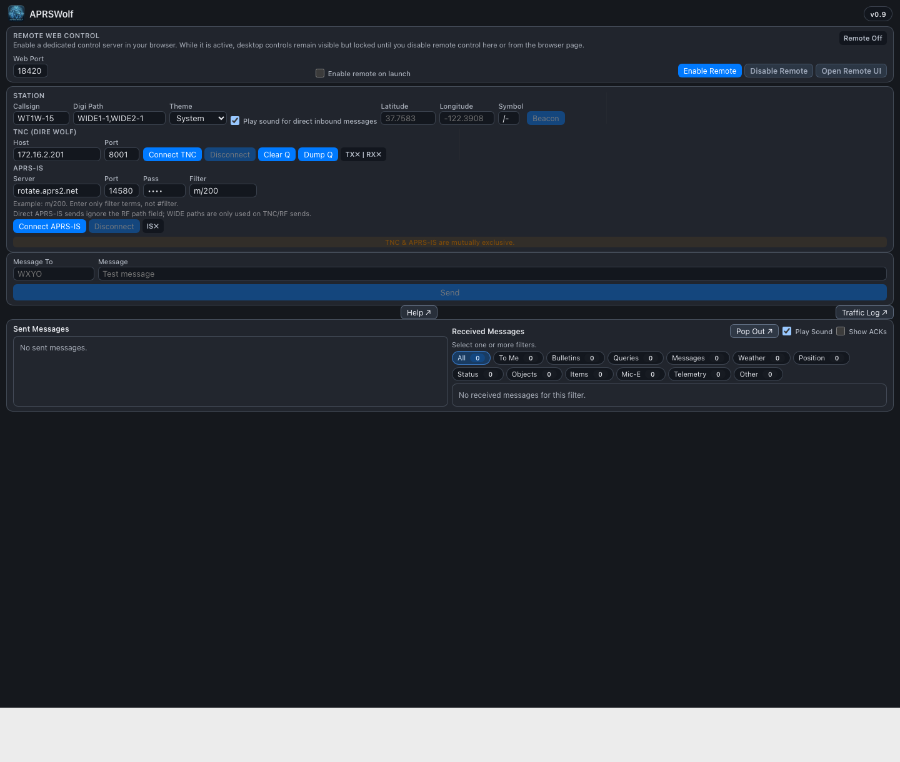

# APRSWolf End-User Guide

## What APRSWolf Is

APRSWolf is a macOS desktop app for APRS messaging.

You can use it in two ways:

- TNC mode: connect to a local or networked Dire Wolf instance over TCP
- APRS-IS mode: connect directly to an APRS-IS server over the internet

Only one connection mode can be active at a time.

## Which Download To Use

Recommended for most users:

- Universal macOS DMG

The current macOS release is published as a universal DMG, so it runs on both Intel and Apple Silicon Macs.

## Quick Start

1. Install APRSWolf from the universal macOS DMG.
2. Open `APRSWolf > Preferences` from the macOS menu bar.
3. Enter your callsign and save at least one connection path.
4. Choose one connection mode from the main window:
	- `Connect TNC` for Dire Wolf / RF use
	- `Connect APRS-IS` for internet APRS use
5. Enter the destination callsign in `Message To`.
6. Type your message and click `Send`.
7. Leave `Show ACKs` off unless you are troubleshooting packet flow.
8. Open `Help > APRSWolf Help` any time you want the built-in topic guide.

## Downloads And Release Files

Primary download:

- `APRSWolf_1.0_universal.dmg`

Use the universal DMG for both Intel and Apple Silicon Macs.

## Installing APRSWolf

1. Open the DMG.
2. Drag APRSWolf into your Applications folder.
3. Open APRSWolf from Applications.
4. If macOS warns that the app was downloaded from the internet, use the normal macOS Open flow.

## First-Time Setup

Use `APRSWolf > Preferences` for all saved setup. The main window is intended for live connections, sending, receiving, and traffic review.

### Station Settings

- Callsign: your APRS callsign, including SSID if needed, such as `WT1W-15`
- Digi Path: the digipeater path to use for RF messaging, such as `WIDE1-1,WIDE2-1`
- Theme: `System`, `Light`, or `Dark`
- Message Sound: plays the default macOS alert sound for messages addressed to you
- Message Font Size: slider to resize sent and received message text (range 10–32px, default 15px)
- Beacon Latitude / Longitude / Symbol: used when sending a manual beacon

### TNC Settings

Use this when talking to Dire Wolf over TCP.

- Host: usually the machine running Dire Wolf
- Port: usually the KISS or compatible TCP port you configured in Dire Wolf

### APRS-IS Settings

Use this when you want internet APRS messaging instead of RF.

- Server: default is usually `rotate.aprs2.net`
- Port: default is usually `14580`
- Pass: APRS-IS passcode for your callsign
- Filter: APRS-IS server-side receive filter. Leave it blank by default unless you want APRSWolf to send a filter command.

### Getting Your APRS-IS Passcode

APRSWolf normally derives the APRS-IS passcode from the callsign you enter in the app.

For most users, that means:

- enter your callsign in the Station section
- check the APRS-IS Pass field
- use the derived value as-is

Important notes:

- APRS-IS passcodes are based on your base callsign
- SSIDs such as `-9` or `-15` do not change the passcode
- if you only want receive-only APRS-IS access, many servers accept `-1`

If you think the passcode is wrong:

- re-check the callsign spelling
- verify the base callsign you are using
- compare it with a trusted APRS-IS passcode tool or server documentation

## Connecting

### TNC Mode

1. Enter your callsign and path.
2. Enter the TNC host and port.
3. Click `Connect TNC`.
4. Wait for the status indicator to show connected TX/RX state.

### APRS-IS Mode

1. Enter your callsign.
2. Enter APRS-IS server, port, and passcode.
3. Leave the receive filter blank unless you want APRSWolf to send one.
4. Click `Connect APRS-IS`.

Important:

- TNC and APRS-IS are mutually exclusive.
- If one is connected, the other mode is disabled until you disconnect.

## Sending A Message

1. In `Message To`, enter the station you want to message.
2. In `Message`, type your text.
3. Click `Send`.

Notes:

- `Message To` is the APRS addressee, not the AX.25 destination.
- The AX.25 destination is always `APRS` internally.
- The app automatically manages APRS message numbering and ACK tracking.

## Receiving Messages

The right-hand pane shows received traffic.

Features:

- Click a received message to open a reply dialog
- Filter received traffic by message type using the filter bar
- Filter to messages addressed to you with the `To Me` filter
- `Messages` shows all APRS message frames, while `To Me` only shows traffic addressed to your station
- Turn on `Promiscuous Base-Call` in the main window if you want `To Me` to also include your base callsign without the SSID
- Hide ACK messages unless you explicitly enable them
- Pop out the received pane into a separate window
- Open the Help window for a task-focused walkthrough without leaving the app

### Received Message Filter Bar

The filter bar appears above the received message list. You can select one or more filters at a time.

Available filters:

| Filter | What it shows |
|---|---|
| All | Every received packet |
| To Me | Only packets addressed to your callsign |
| Bulletins | APRS bulletin messages |
| Messages | APRS message frames |
| Weather | Weather station reports |
| Position | Position reports (! and =) |
| Status | APRS status frames |
| Objects | APRS object reports |
| Items | APRS item reports |
| Mic-E | Mic-E encoded position frames |
| Telemetry | Telemetry frames |
| Other | Anything that does not match the above categories |

To select multiple filters, click each one you want active.
To return to unfiltered view, click `All`.

### APRS-IS Filter Examples

- `m/50`: traffic within 50 miles of your login position
- `r/42.36/-71.06/25`: traffic within 25 miles of a fixed latitude/longitude
- `t/WT1W`: traffic addressed to a specific callsign

Leave the field blank if you do not want APRSWolf to send an APRS-IS filter command. The filter is optional, so you only need to enter it when you want to narrow APRS-IS traffic.

### Pop-Out Received Window

Click the pop-out button in the received pane header to open received messages in a separate window.

The pop-out window has:

- the same filter bar as the main pane
- click-to-reply support
- its own Close Window button

The main pane and pop-out window share the same received message list.

### Show ACKs

The `Show ACKs` checkbox controls whether APRS ACK frames appear in the received list.

- Off: ACK traffic stays hidden
- On: ACK traffic is visible

## Message Sound

When `Message Sound` is enabled:

- APRSWolf plays the default macOS system alert sound
- Only direct messages addressed to your callsign trigger the sound
- ACK messages do not trigger the sound

This is not a macOS notification popup. It is only the system sound.

## Theme / Dark Mode

Theme options:

- `System`: follows macOS appearance automatically
- `Light`: always use the light theme
- `Dark`: always use the dark theme

The selected theme is saved automatically.

## Beacon Button

If you fill in latitude, longitude, and symbol, you can click `Beacon` to send a position beacon.

Notes:

- Beacon sending uses whichever transport is currently connected
- A cooldown timer prevents repeated accidental beacon sends

### Auto-Beacon On Connect

When beacon coordinates and symbol are set, APRSWolf automatically sends a position beacon immediately after a TNC connection is established.

This happens once per connect event. If you do not want an automatic beacon, leave the beacon latitude and longitude fields empty.

## Activity Notice

A brief highlighted banner appears in the main window when a message is sent or received.

- The notice shows for a few seconds and then fades automatically
- It is visible without opening the Traffic Log
- Green-style notices indicate successful TX or RX events; red-style notices indicate errors

This is a quick-glance indicator. Use the Traffic Log for the full history.

## Traffic Log Window

Use `Traffic Log` to open the full scrolling log window.

It is useful for:

- seeing raw receive/transmit activity
- reviewing traffic history
- saving a copy of the log

## In-App Help Window

Use `Help > APRSWolf Help` in the macOS menu bar, or the Help button in the main window, to open the built-in help window.

The Help window is designed like a standard macOS utility window:

- a title bar with search
- a topic sidebar for quick navigation
- a content pane with short user-facing guidance cards

The Help window is the fastest way to check:

- connection setup steps
- APRS-IS filter guidance
- beacon behavior
- receiving and reply workflows
- remote web control behavior
- troubleshooting notes

## Screenshots

### Main APRSWolf Window

This is the main app layout with station settings, connection controls, send form, and the sent/received panes.

### In-App Help Window

This is the built-in Help window with topic navigation, search, and task-focused user guidance.

### Remote Web Control

The remote control page gives you browser-based access to the same saved station and connection setup used by the desktop app.

What you can do from this page:

- connect or disconnect TNC mode
- connect or disconnect APRS-IS mode
- send messages and beacons
- review queue and received message sections

## Where To Look For Help

- In-app Help window: fastest reference while APRSWolf is open
- Traffic Log: best for transport, queue, and receive troubleshooting
- End-user guide: best for first-time setup and full workflow documentation
- Preferences window: manage saved station, theme, ACK visibility, sound, transport, and beacon settings

## Remote Web Control

APRSWolf can expose a remote web control page.

When remote control is enabled:

- the desktop controls remain visible but locked
- you can control APRSWolf from a browser on your network
- the remote UI uses the same persisted settings as the desktop app

Typical use:

1. Set a web port.
2. Click `Enable Remote`.
3. Open the displayed URL in a browser.
4. Use `Disable Remote` when finished.

## Everyday Use Tips

- Use TNC mode for RF messaging through Dire Wolf
- Use APRS-IS mode for internet APRS messaging
- Keep `Show ACKs` off unless you are troubleshooting
- Leave theme on `System` unless you want a fixed look
- Leave `Message Sound` on if you want an audible alert for direct messages

## Troubleshooting

### I cannot connect to Dire Wolf

Check the following:

- Dire Wolf is running
- the TCP port is correct
- your Mac can reach the Dire Wolf host
- Dire Wolf is configured to allow the KISS or compatible TCP connection you are using

### I am connected but not seeing traffic

Check the following:

- your path is appropriate for your RF environment
- your TNC is receiving packets
- your APRS-IS filter is not too restrictive

### I am not hearing the message sound

Check the following:

- `Message Sound` is enabled
- the message is actually addressed to your station
- the packet is not just an ACK
- your Mac output volume is up
- macOS alert sounds are not muted

### I am seeing too much clutter in Received Messages

Try the following:

- turn off `Show ACKs`
- use the received message filters
- use `To Me` when you only care about direct traffic

### The app looks wrong in dark mode

Try the following:

- switch Theme to `System`
- then switch back to `Dark`
- restart the app if needed after a system appearance change

## Data Persistence

APRSWolf automatically saves:

- station settings
- connection settings
- theme selection
- ACK visibility preference
- message sound preference
- received message history

You should not need to re-enter your normal setup every time you launch the app.
