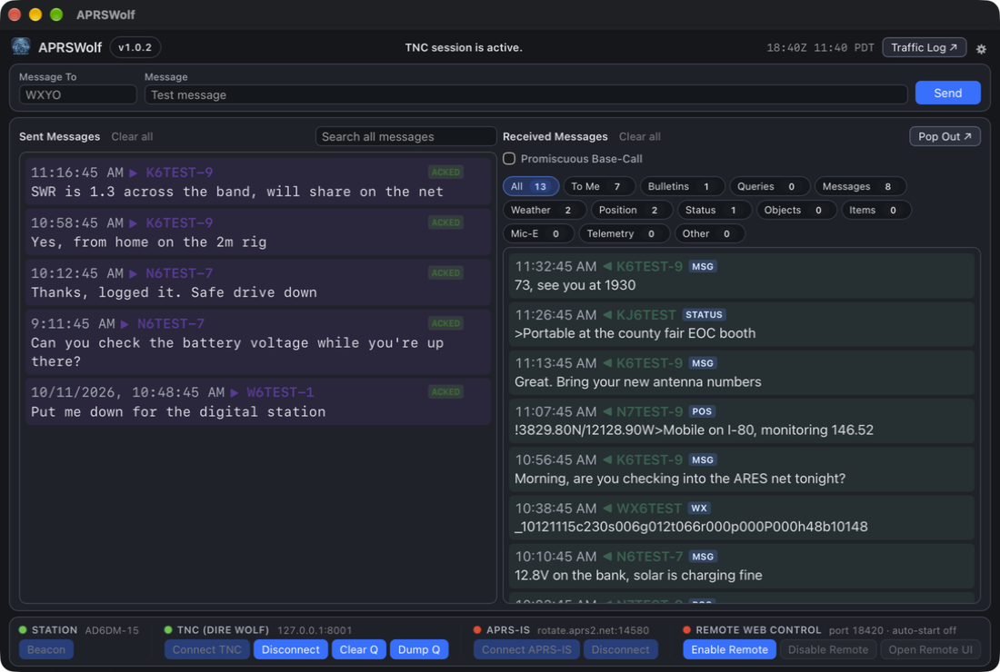
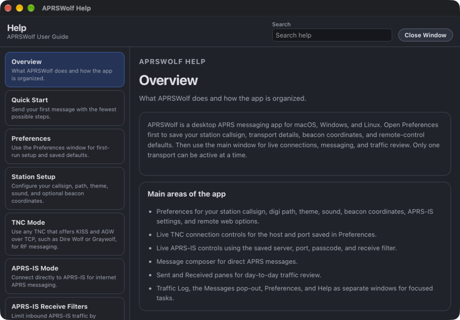
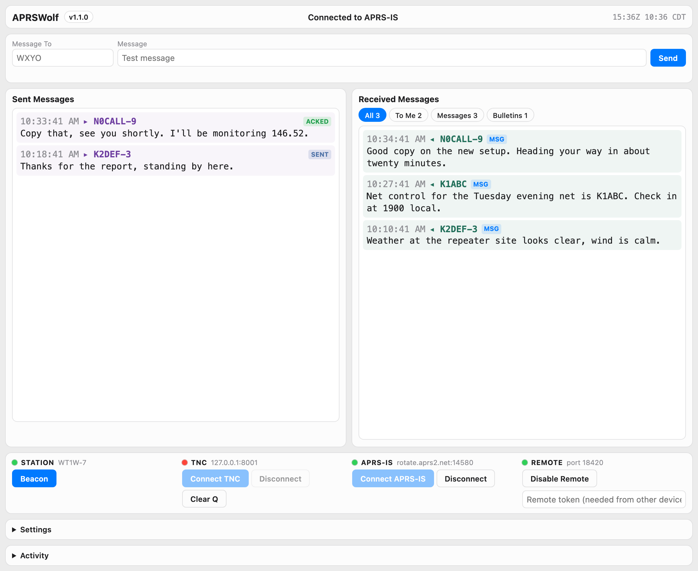
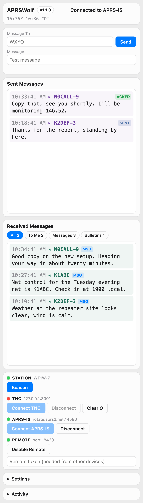

# APRSWolf End-User Guide

## What APRSWolf Is

APRSWolf is a desktop app for APRS messaging. It runs on macOS, Windows, and Linux.

You can use it in two ways:

- TNC mode: connect to a local or networked TNC over TCP. Any TNC that offers KISS and AGW over TCP works, such as Dire Wolf or Graywolf. APRSWolf doesn't include one.
- APRS-IS mode: connect directly to an APRS-IS server over the internet, with no radio

Only one connection mode can be active at a time.

## Which Download To Use

Grab the latest version from the
[Releases page](https://github.com/WT1W-Actual/aprswolf/releases/latest).

| Your computer | Download this |
|---|---|
| Mac, Intel | `APRSWolf_1.1.1_x64.dmg` |
| Mac, Apple Silicon (M1/M2/M3/M4) | `APRSWolf_1.1.1_aarch64.dmg` |
| Windows | `APRSWolf_1.1.1_x64-setup.exe` (or the `.msi`) |
| Linux, Debian or Ubuntu (Intel/AMD 64-bit) | `APRSWolf_1.1.1_amd64.deb` |
| Linux, Debian or Ubuntu (ARM64, e.g. Raspberry Pi OS 64-bit) | `APRSWolf_1.1.1_arm64.deb` |
| Linux, Fedora or openSUSE (Intel/AMD 64-bit) | `APRSWolf-1.1.1-1.amd64.rpm` |
| Linux, Fedora or openSUSE (ARM64) | `APRSWolf-1.1.1-1.arm64.rpm` |
| Linux, any distro (Intel/AMD 64-bit) | `APRSWolf_1.1.1_amd64.AppImage` |
| Linux, any distro (ARM64) | `APRSWolf_1.1.1_arm64.AppImage` |

**Which ARM build do I need?** The `aarch64` DMG is for **Apple Silicon Macs**
(M1 and later). The `arm64` Linux packages are for **ARM64 Linux**, such as a
64-bit Raspberry Pi. They are not interchangeable - pick the one that matches
your operating system, not just the CPU family.

Recommended for most users:

- macOS: the DMG that matches your Mac - `x64` for Intel, `aarch64` for Apple Silicon
- Windows: the `.exe` installer
- Linux: the `.deb` on Debian/Ubuntu, the `.rpm` on Fedora/openSUSE, or the AppImage on any distro

## Quick Start

1. Install APRSWolf for your platform (see [Installing APRSWolf](#installing-aprswolf)).
2. Open `Preferences` with the gear (⚙︎) at the top right of the main window, or from the app menu (macOS: `APRSWolf > Preferences`; Windows/Linux: the Preferences item in the app menu).
3. Enter your callsign and save at least one connection path.
4. Choose one connection mode from the main window:
	- `Connect TNC` for RF use through your TNC
	- `Connect APRS-IS` for internet APRS use
5. Enter the destination callsign in `Message To`.
6. Type your message and click `Send`.
7. Leave `Show ACKs` off unless you are troubleshooting packet flow.
8. Open `Help > APRSWolf Help` any time you want the built-in topic guide.

## Downloads And Release Files

Primary downloads by platform:

- macOS: `APRSWolf_1.1.1_x64.dmg` (Intel) or `APRSWolf_1.1.1_aarch64.dmg` (Apple Silicon)
- Windows: `APRSWolf_1.1.1_x64-setup.exe` (or `APRSWolf_1.1.1_x64.msi`)
- Linux: `APRSWolf_1.1.1_amd64.deb`, `APRSWolf-1.1.1-1.amd64.rpm`, or `APRSWolf_1.1.1_amd64.AppImage`

On Linux, use the `arm64` packages on ARM64 hardware such as a 64-bit Raspberry Pi. On macOS, use `aarch64` for Apple Silicon and `x64` for Intel.

## Installing APRSWolf

### macOS

1. Open the DMG that matches your Mac (`x64` for Intel, `aarch64` for Apple Silicon).
2. Drag APRSWolf into your Applications folder.
3. Open APRSWolf from Applications.
4. If macOS warns that the app was downloaded from the internet, open System Settings → Privacy & Security, scroll down, and click **Open Anyway**.
5. If macOS says APRSWolf "is damaged and can't be opened" (builds before v1.0.3), install v1.0.3 or newer, or run `xattr -cr /Applications/APRSWolf.app` in Terminal and open it again.

### Windows

1. Run the `.exe` (or `.msi`) installer.
2. Follow the installer prompts.
3. Open APRSWolf from the Start menu.
4. If SmartScreen says it protected your PC, click **More info**, then **Run anyway**.

### Linux

- Debian/Ubuntu: install the `.deb` with `sudo apt install ./APRSWolf_1.1.1_amd64.deb`.
- Fedora/openSUSE: install the `.rpm` with `sudo dnf install ./APRSWolf-1.1.1-1.amd64.rpm` (or `zypper install`).
- Any distro (AppImage): make it executable first (`chmod +x APRSWolf_1.1.1_amd64.AppImage`), then run it.

The macOS and Windows builds are not code-signed yet, so the first launch needs the extra click described above.

## First-Time Setup

Use `Preferences` for all saved setup. The main window is intended for live connections, sending, receiving, and traffic review.

### Station Settings

- Callsign: your APRS callsign, including SSID if needed, such as `WT1W-15`
- Digi Path: the digipeater path to use for RF messaging; the default is `WIDE1-1,WIDE2-1`
- Theme: `System`, `Light`, or `Dark`
- Play sound for direct inbound messages: plays the system alert sound for messages addressed to you (macOS only; a no-op on Windows and Linux)
- Show unread To Me count on the app icon: on by default; turn it off to keep the dock or taskbar icon plain
- Message Font Size: slider to resize sent and received message text (range 10–32px, default 15px)
- Beacon Latitude / Longitude / Symbol: used by the `Beacon` button and by automatic beacons

### Message History Settings

- Keep positions, weather and other short-lived packets for: 1 day, 7 days (the default), 30 days, or Keep everything. Messages, queries, and bulletins are always kept until you clear them.

### TNC Settings

Use this when talking to a TNC over TCP.

- Host: defaults to `127.0.0.1` for a TNC on this computer; change it if the TNC runs on another machine
- Port: defaults to `8001`; change it to the TNC's KISS TCP port (`KISSPORT` in Dire Wolf)

APRSWolf sends over the KISS port and receives over the AGW port, which must be one below it (`8000` by default; `AGWPORT` in Dire Wolf). Turn both on in the TNC, or you can send but won't see traffic.

### APRS-IS Settings

Use this when you want internet APRS messaging instead of RF.

- Server: defaults to `rotate.aprs2.net`
- Port: defaults to `14580`
- Pass: APRS-IS passcode for your callsign
- Filter: APRS-IS server-side receive filter. Leave it blank by default unless you want APRSWolf to send a filter command.

### Getting Your APRS-IS Passcode

APRSWolf normally derives the APRS-IS passcode from the callsign you enter in the app.

For most users, that means:

- enter your callsign in the Station section
- check the APRS-IS Pass field
- use the derived value as-is

Important notes:

- APRS-IS passcodes are based on your base callsign
- SSIDs such as `-9` or `-15` do not change the passcode
- if you only want receive-only APRS-IS access, many servers accept `-1`

If you think the passcode is wrong:

- re-check the callsign spelling
- verify the base callsign you are using
- compare it with a trusted APRS-IS passcode tool or server documentation

## Connecting

### TNC Mode

1. Enter your callsign and path.
2. Enter the TNC host and port.
3. Click `Connect TNC`.
4. Wait for the status indicator to show connected TX/RX state.

### APRS-IS Mode

1. Enter your callsign.
2. Enter APRS-IS server, port, and passcode.
3. Leave the receive filter blank unless you want APRSWolf to send one.
4. Click `Connect APRS-IS`.

Important:

- TNC and APRS-IS are mutually exclusive.
- If one is connected, the other mode is disabled until you disconnect.

## Sending A Message

1. In `Message To`, enter the station you want to message.
2. In `Message`, type your text.
3. Click `Send`.

Notes:

- `Message To` is the APRS addressee, not the AX.25 destination.
- The AX.25 destination is always `APRS` internally.
- The app automatically manages APRS message numbering and ACK tracking.

## Receiving Messages

The right-hand pane shows received traffic.

Features:

- Click a received message to open a reply dialog
- Filter received traffic by message type using the filter bar
- Filter to messages addressed to you with the `To Me` filter
- `Messages` shows all APRS message frames, while `To Me` only shows traffic addressed to your station
- Turn on `Promiscuous Base-Call` in the main window if you want `To Me` to also include your base callsign without the SSID
- Hide ACK messages unless you explicitly enable them
- See a red count on `To Me` for messages addressed to you that arrived while APRSWolf was in the background; the app icon shows the same count unless you turn it off in Preferences
- Search sent and received messages from the field in the Sent Messages header
- Right-click an expired sent message and choose `Resend` to queue it again under its original message number. It's refused while another message to that station is still waiting for an ack under the same number, or when the callsign in Preferences differs from the one the message was sent as
- Hide or delete messages (see [Searching And Clearing Messages](#searching-and-clearing-messages))
- Pop out a separate Messages window that shows sent and received together
- Open the Help window for a task-focused walkthrough without leaving the app

A packet heard twice, over RF and APRS-IS or through two digipeaters, is listed once. The Traffic Log still shows both copies, the second tagged `(duplicate)`.

### Received Message Filter Bar

The filter bar appears above the received message list. You can select one or more filters at a time.

Available filters:

| Filter | What it shows |
|---|---|
| All | Every received packet |
| To Me | Only packets addressed to your callsign |
| Bulletins | APRS bulletin messages |
| Messages | APRS message frames |
| Weather | Weather station reports |
| Position | Position reports (! and =) |
| Status | APRS status frames |
| Objects | APRS object reports |
| Items | APRS item reports |
| Mic-E | Mic-E encoded position frames |
| Telemetry | Telemetry frames |
| Other | Anything that does not match the above categories |

To select multiple filters, click each one you want active.
To return to unfiltered view, click `All`.

### APRS-IS Filter Examples

- `m/50`: traffic within 50 miles of your login position
- `r/42.36/-71.06/25`: traffic within 25 miles of a fixed latitude/longitude
- `t/WT1W`: traffic addressed to a specific callsign

Leave the field blank if you do not want APRSWolf to send an APRS-IS filter command. The filter is optional, so you only need to enter it when you want to narrow APRS-IS traffic.

### Messages Window (Pop Out)

Click `Pop Out ↗` in the Received Messages header to open the Messages window.

The Messages window has:

- sent and received messages in one timeline, newest first; sent ones are purple and show their delivery status
- the same filter bar as the main pane (sent messages show under `All` and `Messages`)
- its own search field, covering sent and received
- `Load older messages` at the bottom for the next 200
- click-to-reply on received messages
- `Clear all` and its own Close Window button

While it's open, the main window's Received pane points you to it.

## Searching And Clearing Messages

Sent and received messages are kept across restarts. Type in the search field in the Sent Messages header to search callsigns and message text across the whole history. Both panes filter as you type; clear the field to go back to the normal lists.

To clear messages:

- Hover a message and click `×` to clear it.
- `Clear all`, beside each pane's title, clears the messages that pane shows: up to the newest 200, after any filter chips. Older history isn't touched.
- Hold a message for half a second to start selecting. A checkbox appears on every message; check the ones you want, then click `×` on any checked message. `Done` or Escape leaves selection.

Each opens a dialog with a `Delete from database` box, unchecked by default:

- Unchecked: the messages leave the list but stay in the database. Search still finds them, marked `HIDDEN`, and `↺` beside a hidden result puts it back in its list.
- Checked: the messages are deleted and no search finds them.

### Exporting Messages

Choose `File > Export Messages...` (Cmd+Shift+E on macOS, Ctrl+Shift+E on Windows and Linux). The Export Messages window opens; click `Export...`, pick where to save, and APRSWolf writes a CSV file and tells you how many messages it saved. The suggested file name ends with the date and time, such as `aprswolf-messages-2026-10-12-143005.csv`, so several exports in one day each get their own file. The file opens in Numbers, Excel, or LibreOffice; times in it are in UTC.

Left as it opens, the window exports your sent messages and received messages, queries, and bulletins, oldest first, hidden ones included. To narrow the file:

- Choose `Sent and received`, `Received only`, or `Sent only`.
- Check `Only messages new since the last new-only export` to pick up where your last such export stopped. The first one takes everything; one right after it is empty. Only a new-only export with no other filter counts as the last one, so messages a narrower export left out still come along next time. A message still waiting for its ack, or still missing a later part, goes out again in the next new-only export once the ack or the last part arrives.
- Check `Limit to a date range` and set From and To. Both days are included.
- Enter callsigns, separated by commas, to keep messages to or from them. `K6ABC` matches every SSID; `K6ABC-9` matches only that one.
- Check `Include positions, weather, and other short-lived packets` to add them. APRSWolf warns first that those packets are removed after the retention period set in Preferences, so only the ones still stored are exported.

### Importing Messages

Choose `File > Import Messages...` (Cmd+Shift+I on macOS, Ctrl+Shift+I on Windows and Linux) and pick a CSV export, from this computer or another, even one you edited in a spreadsheet. Imported messages show in the lists at their own time. Messages already in your history are skipped, so importing a file twice does no harm. A copy that's further along updates the one you have: an acked message over one still marked expired, or a multipart message with its later parts. A row you typed in yourself needs `direction` (sent or received), `from`, `body`, and `timestamp`; sent rows also need `to` and a `status` of acked, failed, or expired. A time without a zone is read as UTC, and a time in the future is refused.

APRSWolf checks every row first. If one is wrong, nothing is imported, and the dialog names each bad row and what to fix. If the file holds positions, weather, or other short-lived packets older than your retention setting, you're asked before they're stored; `Cancel` leaves your history unchanged.

### Show ACKs

The `Show ACKs` checkbox controls whether APRS ACK frames appear in the received list.

- Off: ACK traffic stays hidden
- On: ACK traffic is visible

## Message Sound

When `Play sound for direct inbound messages` is checked in Preferences:

- APRSWolf plays the system alert sound (macOS only; on Windows and Linux this is a no-op)
- Only direct messages addressed to your callsign trigger the sound
- ACK messages do not trigger the sound

This is not a system notification popup. It is only the alert sound.

## Theme / Dark Mode

Theme options:

- `System`: follows your operating system appearance automatically
- `Light`: always use the light theme
- `Dark`: always use the dark theme

The selected theme is saved automatically.

## Beacon Button

If you fill in latitude, longitude, and symbol, you can click `Beacon` to send a position beacon.

Notes:

- Beacon sending uses whichever transport is currently connected
- A cooldown timer prevents repeated accidental beacon sends

### Automatic Beacons

Automatic beacons are off by default. In Preferences under Beacon, check `Beacon on connect` to send one each time a connection is made, and set `Auto-beacon every` to send one on a timer. Both need beacon coordinates and a symbol.

## Activity Notice

A brief highlighted banner appears in the main window when a message is sent or received.

- The notice shows for a few seconds and then fades automatically
- It is visible without opening the Traffic Log
- Green-style notices indicate successful TX or RX events; red-style notices indicate errors

This is a quick-glance indicator. Use the Traffic Log for the full history.

## Traffic Log Window

Use `Traffic Log` to open the full scrolling log window.

It is useful for:

- seeing raw receive/transmit activity
- reviewing traffic history
- saving a copy of the log

## In-App Help Window

Use `Help > APRSWolf Help` in the app menu to open the built-in help window.

The Help window is designed like a standard utility window:

- a title bar with search
- a topic sidebar for quick navigation
- a content pane with short user-facing guidance cards

The Help window is the fastest way to check:

- connection setup steps
- APRS-IS filter guidance
- beacon behavior
- receiving and reply workflows
- remote web control behavior
- troubleshooting notes

Escape closes the Help window, as it does Preferences and the About window.

## About Window

`APRSWolf > About APRSWolf` shows the version, what APRSWolf works with, and the credits. Its `GitHub`, `Release notes`, and `Help` links open the project page, the notes for your version, or the Help window, and close the About window. Escape closes it too.

## Menu Shortcuts

| Action | macOS | Windows and Linux |
|---|---|---|
| Preferences | Cmd+, | Ctrl+, |
| APRSWolf Help | Cmd+Shift+/ | Ctrl+Shift+/ |
| Export Messages | Cmd+Shift+E | Ctrl+Shift+E |
| Import Messages | Cmd+Shift+I | Ctrl+Shift+I |

Escape closes Preferences, Help, and About.

## Screenshots

### Main APRSWolf Window

This is the main window: the send row, the Sent and Received panes with the filter chips, and the bottom bar with Station, TNC, APRS-IS, and Remote Web Control.

### In-App Help Window

This is the built-in Help window with topic navigation, search, and task-focused user guidance.

### Remote Web Control

The remote control page gives you browser-based access to the same saved station and connection setup used by the desktop app.

What you can do from this page:

- send messages from the send row at the top, laid out like the desktop main window
- read sent and received messages side by side, filtered with All, To Me, Messages, and Bulletins (acks stay hidden unless Show ACKs is on in the desktop app's Preferences), and tap a received message to reply to its sender
- connect or disconnect TNC or APRS-IS mode, send a beacon, and clear the queue from the bottom bar, where each has its status dot
- change station and connection settings under Settings, and follow events under Activity; a field you've changed keeps your edit until you click Save, even while new traffic arrives
- turn remote control off with Disable Remote

On a phone the Sent and Received panes stack.

## Where To Look For Help

- In-app Help window: fastest reference while APRSWolf is open
- Traffic Log: best for transport, queue, and receive troubleshooting
- End-user guide: best for first-time setup and full workflow documentation
- Preferences window: manage saved station, theme, ACK visibility, sound, transport, and beacon settings

## Remote Web Control

APRSWolf can expose a remote web control page. This works the same way on macOS, Windows, and Linux.

When remote control is enabled:

- the desktop controls remain visible but locked
- you can control APRSWolf from a browser on your network
- the remote UI uses the same persisted settings as the desktop app
- `Open Remote UI` opens the displayed URL in your system browser from the desktop app

Typical use:

1. Leave the default web port (`18420`) or choose another available port.
2. Click `Enable Remote`.
3. Click `Open Remote UI` to open the page on this computer, or open the displayed URL in another device's browser.
4. Use `Disable Remote` when finished.

The remote token is empty by default, which restricts the server to this computer. Set a token before connecting from another device on your network. The `Enable remote on launch` preference is off by default.

## Everyday Use Tips

- Use TNC mode for RF messaging through your TNC
- Use APRS-IS mode for internet APRS messaging
- Keep `Show ACKs` off unless you are troubleshooting
- Leave theme on `System` unless you want a fixed look
- Leave `Play sound for direct inbound messages` on if you want an audible alert for direct messages

## Troubleshooting

### I cannot connect to the TNC

Check the following:

- the TNC is running
- the TCP port is its KISS port
- your computer can reach the TNC's host
- the TNC has KISS over TCP turned on, and AGW one port below it (in Dire Wolf, `KISSPORT` and `AGWPORT` in `direwolf.conf`)

### I am connected but not seeing traffic

Check the following:

- your path is appropriate for your RF environment
- your TNC is receiving packets
- your APRS-IS filter is not too restrictive

### I am not hearing the message sound

Check the following:

- `Play sound for direct inbound messages` is checked in Preferences
- you are on macOS (the alert sound is macOS only; it is a no-op on Windows and Linux)
- the message is actually addressed to your station
- the packet is not just an ACK
- your system output volume is up
- system alert sounds are not muted

### I am seeing too much clutter in Received Messages

Try the following:

- turn off `Show ACKs`
- use the received message filters
- use `To Me` when you only care about direct traffic

### The app looks wrong in dark mode

Try the following:

- switch Theme to `System`
- then switch back to `Dark`
- restart the app if needed after a system appearance change

## Data Persistence

APRSWolf automatically saves:

- station settings
- connection settings
- theme selection
- ACK visibility preference
- message sound and app icon count preferences
- message history retention
- sent and received message history, in `messages.db` in the app data folder

You should not need to re-enter your normal setup every time you launch the app.
